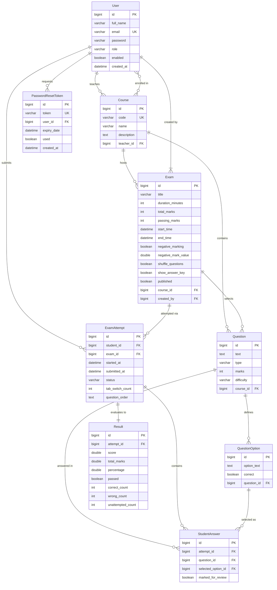

# Online Examination Management System

An institutional-grade, full-stack Online Examination Management System built with **Java 17**, **Spring Boot 3.2.5**, **Spring Security 6**, **Spring Data JPA**, **Thymeleaf**, and **MySQL**. Designed specifically for colleges and universities to manage the end-to-end examination lifecycle—from question authoring and timed test delivery to auto-evaluation, proctoring, analytics, and PDF/Excel reporting.

The user interface adheres strictly to an **institutional white and charcoal theme** (`#ffffff` background, `#212529` primary buttons and navigation, `#e5e5e5` borders, 8–12px card radii) for a distraction-free examination experience.

---

## Table of Contents
- [Key Features by Role](#key-features-by-role)
  - [Administrator Portal](#1-administrator-portal)
  - [Faculty / Teacher Portal](#2-faculty--teacher-portal)
  - [Student Portal & Exam Engine](#3-student-portal--exam-engine)
  - [Security & Authentication](#4-security--authentication)
- [Technology Stack](#technology-stack)
- [Entity-Relationship (ER) Diagram](#entity-relationship-er-diagram)
- [Installation & Local Setup](#installation--local-setup)
- [Default Login Credentials](#default-login-credentials)
- [API & Route Map](#api--route-map)
- [Screenshots & UI Showcase](#screenshots--ui-showcase)
- [Running Unit Tests](#running-unit-tests)

---

## Key Features by Role

### 1. Administrator Portal
- **Dashboard & Cross-Course Analytics**: Real-time KPI summary cards (Total Students, Teachers, Courses, Exams) and a dynamic **Chart.js** bar chart depicting exams hosted per course.
- **User Account Management**: Searchable, paginated user table with role badges, enable/disable status toggles, and deletion with self-deletion protection.
- **Teacher Onboarding**: Direct administrator form to create faculty accounts with automated email notifications.
- **Course Administration**: Create, update, or remove courses, manage course codes, and assign faculty instructors via an interactive selector.
- **Student Enrollment**: Assign students to designated academic courses to govern examination access.
- **Institutional Performance Reports (`/admin/reports`)**:
  - Multi-criteria filtering by **Course**, **Exam**, **Date Range** (from/to), and **Pass/Fail Outcome**.
  - Performance overview: Total submissions, passed count, failed count, overall pass rate, and mean exam score.
  - Comprehensive assessment record table with student details and question breakdown badges.
  - **Excel Export**: Generate comprehensive `.xlsx` reports via Apache POI.

### 2. Faculty / Teacher Portal
- **Scoped Course Access**: Teachers are restricted to managing only courses, questions, and exams explicitly assigned to them.
- **Question Bank (`/teacher/questions`)**:
  - Filter questions by assigned course and difficulty level (**Easy**, **Medium**, **Hard**).
  - Add/Edit supporting **Multiple Choice (MCQ)** (4 options, single correct) and **True/False** questions.
  - **CSV Bulk Upload**: Upload batches of questions via CSV with real-time row-by-row validation reporting accepted vs. rejected counts.
- **Exam Management (`/teacher/exams`)**:
  - Configure exam title, course, duration (minutes), passing marks, schedule window (`startTime` to `endTime`), negative marking penalty, question shuffling, and answer key visibility.
  - **Question Selection Checklist**: Pick questions from the course bank with an auto-calculating total marks counter.
  - **Publishing Safeguards**: Validates that questions exist, passing marks do not exceed total marks, and locks question modifications once student attempts are recorded.
- **Leaderboards & Exam Analytics (`/teacher/exams/{id}/results`)**:
  - Overview cards: Average Score, Highest Score, Lowest Score, Pass Percentage.
  - **Chart.js Score Distribution**: Visual bar chart bucketing student performance across 5 brackets (`0-20%`, `21-40%`, `41-60%`, `61-80%`, `81-100%`).
  - Ranked student leaderboard with score, percentage, status, and completion timestamp.
  - **Excel Export (`.xlsx`)**: Export styled exam results using Apache POI.
  - **Individual Submission Audit**: Question-by-question review with **proctored tab-switch alerts** to detect exam window switching.

### 3. Student Portal & Exam Engine
- **Student Dashboard (`/student/dashboard`)**: Displays enrolled courses and lists upcoming, ongoing, and completed exams.
- **Available Exams**: Real-time status indicators (**Upcoming**, **Ongoing**, **Completed**, **Closed**) with server-enforced time-window validation.
- **Pre-Exam Instructions (`/student/exams/{id}/instructions`)**: Exam rules, duration, mark breakdown, negative marking warning, and honor code checkbox.
- **Live Examination Session (`/student/exams/{id}/take`)**:
  - **Fixed Top Bar**: Exam title, candidate name, autosave indicator, and countdown timer.
  - **Adaptive Countdown Timer**: Color-coded timer badge (turns amber under 5 minutes, red under 1 minute) that automatically submits the exam upon expiry.
  - **Single Question Card**: Radio option selectors, Clear Answer, Mark for Review, and Next/Previous navigation buttons.
  - **Interactive Question Palette**: Visual grid reflecting real-time state (Green = Answered, Amber = Marked for Review, Grey = Not Visited).
  - **Asynchronous Autosave**: AJAX background saving on each option selection with CSRF token protection.
  - **Anti-Malpractice Tab-Switch Detection**: Monitors window blur and tab switching, alerts the student with a warning modal, and increments a server-side counter.
  - **Submission Confirmation Modal**: Displays a summary of answered, unanswered, and marked-for-review counts before final submission.
- **Evaluation & Result Scorecard (`/student/results/{attemptId}`)**:
  - Automated grading with negative marking deductions floored at 0.0.
  - Scorecard with Pass/Fail badge, score vs. total, percentage, correct/wrong/unattempted breakdown, and accuracy.
  - Question review table displaying question text, student's response, and correct answer (only visible if permitted by instructor).
  - **PDF Scorecard Download**: Generates an official examination scorecard PDF via OpenPDF.
  - **My Results History (`/student/results`)**: Historical catalog of all attempted exams.

### 4. Security & Authentication
- **Role-Based Access Control**: URL authorization rules enforce role separation (`/admin/**` for `ADMIN`, `/teacher/**` for `TEACHER`, `/student/**` for `STUDENT`).
- **Ownership Verification**: Teacher and student data access verified on the server to prevent horizontal privilege escalation.
- **CSRF Defense**: Synchronizer token protection applied to all HTTP POST forms and AJAX requests.
- **Spring Mail Notifications**: Automated welcome emails, exam result score notifications, and password reset instructions (with optional toggle `app.mail.enabled`).
- **Forgot Password Flow**: Secure 15-minute time-limited password reset tokens sent via email.
- **Global Error Handling**: Custom friendly error pages (`403.html`, `404.html`, `500.html`) and centralized exception logging.

---

## Technology Stack

| Layer | Technology |
|---|---|
| **Language & Platform** | Java 17 (OpenJDK / Oracle JDK) |
| **Framework** | Spring Boot 3.2.5 |
| **Security** | Spring Security 6 (BCrypt Password Encoding, Form Login, Role-Based Access) |
| **Persistence & ORM** | Spring Data JPA, Hibernate 6 |
| **Database** | MySQL 8.x (`exam_db`) |
| **View Engine** | Thymeleaf, Thymeleaf Extras for Spring Security 6 |
| **PDF Generation** | OpenPDF 1.3.40 |
| **Excel Export** | Apache POI 5.2.5 (`poi-ooxml`) |
| **Email Service** | Spring Boot Starter Mail (JavaMailSender) |
| **Data Visualizations** | Chart.js 4.4.1 (CDN) |
| **Frontend Styling** | Bootstrap 5.3.3 (CDN), Bootstrap Icons 1.11.3 (CDN), Vanilla CSS & JS |
| **Build & Testing** | Apache Maven, JUnit 5, Mockito |

---

## Entity-Relationship (ER) Diagram



---

## Installation & Local Setup

### 1. Prerequisites
- **JDK 17** or higher installed and configured on your system path.
- **Apache Maven 3.8+** installed.
- **MySQL Server 8.x** running locally on port `3306`.

### 2. Database Creation
Connect to your local MySQL instance and run:
```sql
CREATE DATABASE IF NOT EXISTS exam_db 
    CHARACTER SET utf8mb4 
    COLLATE utf8mb4_unicode_ci;
```

### 3. Application Properties
Open `src/main/resources/application.properties` and verify your local database settings:
```properties
spring.datasource.url=jdbc:mysql://localhost:3306/exam_db?createDatabaseIfNotExist=true&useSSL=false&serverTimezone=UTC&allowPublicKeyRetrieval=true
spring.datasource.username=root
spring.datasource.password=YOUR_PASSWORD

# Email Delivery Flag (Set true to send live emails via SMTP)
app.mail.enabled=false
app.app-url=http://localhost:8080
```
> **Note**: When `app.mail.enabled=false`, simulated email events (welcome emails, exam evaluations, password resets) are safely logged to the console without requiring live SMTP credentials.

### 4. Running the Application
From the project root directory, run:
```bash
mvn spring-boot:run
```
> **Note on Windows**: Execute `mvn spring-boot:run` or `mvn test` directly without running `mvn clean` to prevent temporary Windows file locks on OneDrive-synced directories.

Access the portal in your browser:
**`http://localhost:8080`**

---

## Default Login Credentials

Initial accounts are pre-populated into the database upon initial startup:

| Role | Email Address | Password | Permissions & Dashboard |
|---|---|---|---|
| **Administrator** | `admin@college.edu` | `admin123` | Full system governance (`/admin/dashboard`) |
| **Faculty / Teacher** | `teacher@college.edu` | `teacher123` | Assigned to CS101 & CS102 (`/teacher/dashboard`) |
| **Faculty / Teacher** | `sarah@college.edu` | `teacher123` | Assigned to MA201 (`/teacher/dashboard`) |
| **Student** | `student@college.edu` | `student123` | Enrolled in CS101 (`/student/dashboard`) |
| **Student** | `emma@college.edu` | `student123` | Enrolled in CS101 & MA201 (`/student/dashboard`) |

New students and teachers may also self-register at `/register`, or teachers can be onboarded directly by the administrator.

---

## API & Route Map

### Public & Authentication
- `GET /` — Public landing page with portal overview.
- `GET /login` — Authentication sign-in form.
- `POST /login` — Form login processing with role-based redirect handler.
- `GET /register` — Student/Teacher self-registration form.
- `POST /register` — Registration validation and account creation.
- `GET /forgot-password` — Password reset request form.
- `POST /forgot-password` — Token generation and reset email dispatch.
- `GET /reset-password?token=...` — Password reset form with token validation.
- `POST /reset-password` — Password update with BCrypt encoding.

### Administrator (`/admin/**`)
- `GET /admin/dashboard` — Live metric cards and Chart.js exam distribution chart.
- `GET /admin/users` — Paginated user catalog with search and status filters.
- `POST /admin/users/status/{id}` — Enable or disable a user account.
- `POST /admin/users/delete/{id}` — Delete user account (with admin self-protection).
- `GET /admin/teachers/new` — Create teacher form.
- `POST /admin/teachers` — Process teacher creation.
- `GET /admin/courses` — Course listing with assigned instructors.
- `GET /admin/courses/new` — Create course form.
- `POST /admin/courses` — Process course creation.
- `GET /admin/courses/edit/{id}` — Edit course form.
- `POST /admin/courses/edit/{id}` — Update course.
- `POST /admin/courses/delete/{id}` — Delete course.
- `GET /admin/courses/enroll` — Student course enrollment selector.
- `POST /admin/courses/enroll` — Persist student enrollments.
- `GET /admin/reports` — Institutional assessment reports with multi-criteria filters.
- `GET /admin/reports/excel` — Download filtered report as an Excel `.xlsx` file.

### Teacher (`/teacher/**`)
- `GET /teacher/dashboard` — Faculty dashboard with course summary cards.
- `GET /teacher/questions` — Question bank table filtered by course and difficulty.
- `GET /teacher/questions/new` — Question creation form (MCQ & True/False).
- `POST /teacher/questions` — Save new question.
- `GET /teacher/questions/edit/{id}` — Edit question form.
- `POST /teacher/questions/edit/{id}` — Update question.
- `POST /teacher/questions/delete/{id}` — Delete question.
- `GET /teacher/questions/bulk-upload` — CSV upload form.
- `POST /teacher/questions/bulk-upload` — Process CSV bulk upload.
- `GET /teacher/exams` — Exam management table with schedule badges.
- `GET /teacher/exams/new` — Exam creation form.
- `POST /teacher/exams` — Save exam draft.
- `GET /teacher/exams/edit/{id}` — Edit exam form.
- `POST /teacher/exams/edit/{id}` — Update exam details.
- `POST /teacher/exams/delete/{id}` — Delete exam (prevented if attempts exist).
- `POST /teacher/exams/{id}/toggle-publish` — Publish or unpublish exam.
- `GET /teacher/exams/{id}/questions` — Select questions checklist with auto-marks.
- `POST /teacher/exams/{id}/questions` — Save selected questions.
- `GET /teacher/results` — Overview of all exams and submission metrics.
- `GET /teacher/exams/{id}/results` — Detailed leaderboard and score distribution chart.
- `GET /teacher/exams/{id}/results/excel` — Export exam results as an Excel `.xlsx` file.
- `GET /teacher/exams/{id}/submissions/{attemptId}` — Question-by-question student audit with tab-switch alerts.

### Student (`/student/**`)
- `GET /student/dashboard` — Enrolled course summary and upcoming/ongoing exams.
- `GET /student/exams` — Available exams catalog.
- `GET /student/exams/{id}/instructions` — Pre-exam instructions and rules acknowledgment.
- `POST /student/exams/{id}/start` — Start new attempt or resume active session.
- `GET /student/exams/{id}/take` — Live exam-taking screen with timer and palette.
- `POST /student/attempts/{attemptId}/save-answer` — Asynchronous AJAX answer auto-saving.
- `POST /student/attempts/{attemptId}/tab-switch` — Record tab switch proctoring event.
- `POST /student/attempts/{attemptId}/submit` — Final exam submission.
- `GET /student/attempts/{attemptId}/submitted` — Submission confirmation screen.
- `GET /student/results` — Student results history page.
- `GET /student/results/{attemptId}` — Detailed score card and review table.
- `GET /student/results/{attemptId}/pdf` — Download official score report as PDF.

---

## Screenshots & UI Showcase

The portal provides structured views designed for desktop, tablet, and mobile displays:

| View | Purpose & Highlights |
|---|---|
| **Sign In & Forgot Password** | Centered white card with institutional branding, form validation messages, and 15-minute token reset workflow. |
| **Admin Dashboard** | Real-time metric KPI cards and a Chart.js bar chart of exams per course. |
| **Question Bank & Bulk Upload** | Multi-filter table with course and difficulty dropdowns, plus CSV import with row-by-row error auditing. |
| **Exam Builder & Question Picker** | Exam form with date-time pickers, negative marking settings, and checklist with dynamic marks calculation. |
| **Live Examination Screen** | Countdown timer with color alerts, single-question view, question palette grid, tab-switch warning modal, and autosave indicator. |
| **Teacher Exam Leaderboard** | Score distribution histogram (Chart.js), ranked candidate leaderboard, and Apache POI Excel export. |
| **Student Scorecard & PDF** | Pass/Fail badge, accuracy percentage, question review table, and downloadable OpenPDF scorecard. |
| **Admin Reports & Filters** | Cross-course filtering (course, exam, date range, pass/fail status) with statistical summaries and Excel download. |

---

## Running Unit Tests

The test suite covers service layer calculations, negative marking, pass/fail threshold boundaries, exam validation, attempt timers, tab-switch recording, password reset tokens, and report filters:

```bash
mvn test
```

### Test Suite Summary
```
[INFO] Running com.examportal.service.EvaluationServiceTest
[INFO] Tests run: 6, Failures: 0, Errors: 0, Skipped: 0
[INFO] Running com.examportal.service.ExamAttemptServiceTest
[INFO] Tests run: 5, Failures: 0, Errors: 0, Skipped: 0
[INFO] Running com.examportal.service.ExamServiceTest
[INFO] Tests run: 6, Failures: 0, Errors: 0, Skipped: 0
[INFO] Running com.examportal.service.PasswordResetServiceTest
[INFO] Tests run: 6, Failures: 0, Errors: 0, Skipped: 0
[INFO] Running com.examportal.service.ReportServiceTest
[INFO] Tests run: 5, Failures: 0, Errors: 0, Skipped: 0
[INFO] 
[INFO] Results:
[INFO] Tests run: 28, Failures: 0, Errors: 0, Skipped: 0
[INFO] BUILD SUCCESS
```
